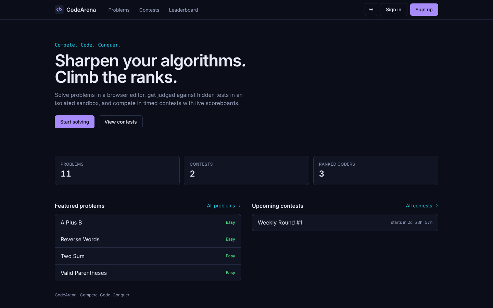
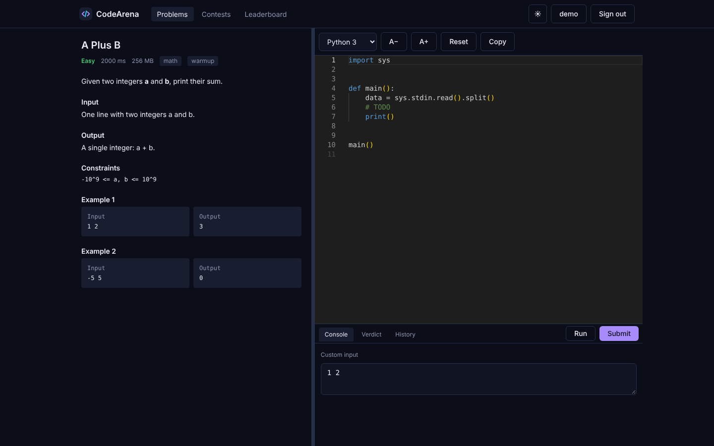
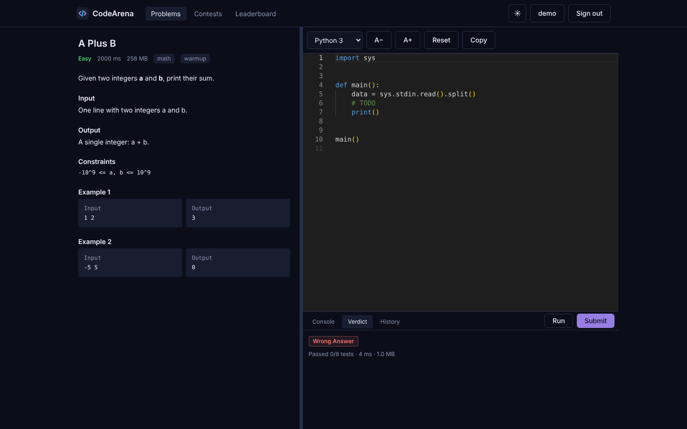
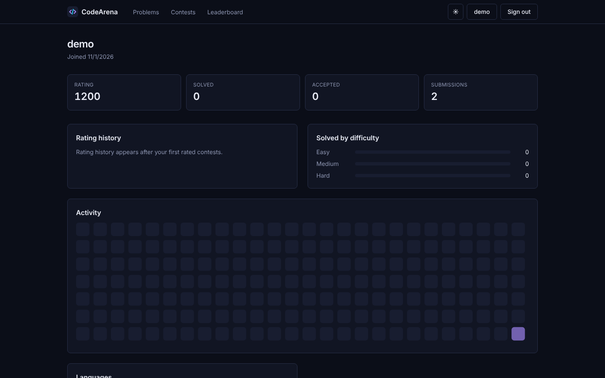
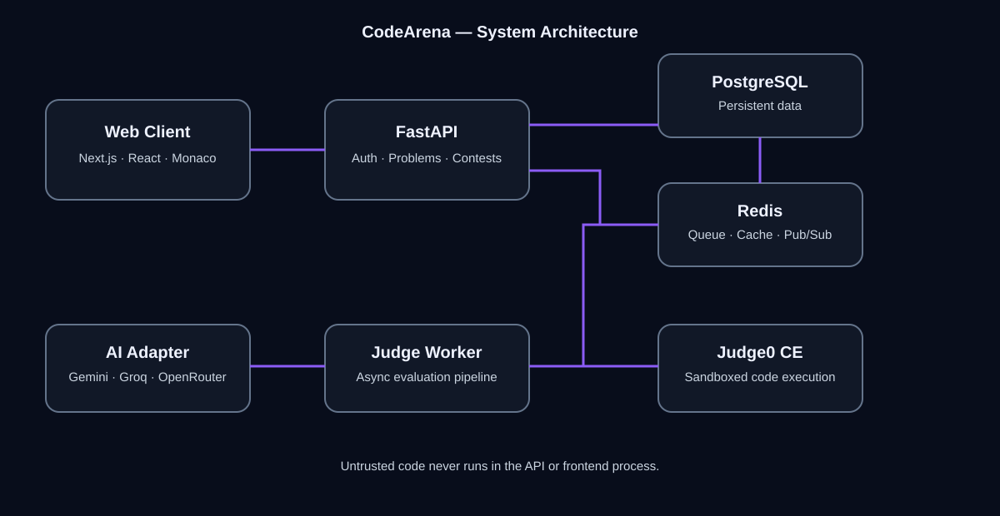

<p align="center"></p>

# CodeArena — Compete. Code. Conquer.

A full-stack competitive-programming platform: solve problems in a browser editor, get judged against hidden tests
in an isolated sandbox, and compete in timed contests with live scoreboards and ratings. AI help is optional and
never part of judging.

> **Status:** working vertical slice. Backend tests, frontend checks and a browser smoke test pass.
> **Real Judge0 sandboxing has not been exercised yet** — see [docs/IMPLEMENTATION_STATUS.md](docs/IMPLEMENTATION_STATUS.md).

| | |
|---|---|
|  |  |
|  |  |

*Screenshots are real captures of the running app (judged by the dev-only fake judge).*

## Features
- **Practice:** problem catalogue (search, difficulty/tag/status filters, pagination), Monaco editor (Python, C++, Java, JavaScript), custom-input runs, hidden-test submissions, verdict + submission history.
- **Contests:** registration, server-time enforcement, penalties, deterministic tie-breaks, scoreboard freeze, admin full view, Elo-style rating updates.
- **Community:** global leaderboard, profiles with rating chart, activity heatmap, solved-by-difficulty.
- **Admin:** create/publish problems and contests, judge health, rejudge, audit log.
- **AI assistant (optional, off by default):** hints and code explanation via Gemini/Groq/OpenRouter; only public problem text + code you choose to share is sent; never grades.
- **Quality:** dark-first responsive UI with light theme, skeleton/empty/error states, accessible controls.

## Architecture


Browser → **Next.js** → **FastAPI** (auth, validation, RBAC, persistence) → **PostgreSQL**; submissions are queued in **Redis**, a separate
**judge worker** calls **Judge0 CE** (the only place code runs), persists per-test results and the final verdict in one transaction.
Details: [docs/ARCHITECTURE.md](docs/ARCHITECTURE.md), [docs/DATA_MODEL.md](docs/DATA_MODEL.md), [docs/SECURITY.md](docs/SECURITY.md).

**Core security rules:** submitted code never runs in the API or web process · hidden test data never appears in any public schema, the client bundle, or LLM prompts ·
verdict/score/time are never trusted from the client · server time is authoritative for contests.

## Stack
Next.js 15 (App Router) · React 19 · TypeScript (strict) · Tailwind · Monaco · FastAPI · SQLAlchemy 2 · Alembic · PostgreSQL 16 · Redis ·
Judge0 CE · Argon2id · Pytest · Vitest · Playwright · Ruff · ESLint · Docker Compose · GitHub Actions.

## Quick start
```bash
cp .env.example .env                 # set JWT_SECRET (openssl rand -hex 32)
docker compose up -d --build         # web :3000, api :8000, worker, postgres, redis
```
Open http://localhost:3000 and register. API docs: http://localhost:8000/docs.

For real sandboxed judging add Judge0 (`docker compose --profile judge up -d`) — setup and host requirements in
[docs/DEVELOPMENT.md](docs/DEVELOPMENT.md). For UI work without Judge0 set `JUDGE_BACKEND=fake` (dev/CI only, never runs code).
Running services directly on the host (macOS/Linux/PowerShell commands): see [docs/DEVELOPMENT.md](docs/DEVELOPMENT.md).

## Configuration
All variables are in [.env.example](.env.example) (placeholders only). Key ones: `JWT_SECRET`, `DATABASE_URL`, `REDIS_URL`, `JUDGE_BACKEND`,
`JUDGE0_BASE_URL`, `JUDGE0_AUTH_TOKEN`, `LLM_PROVIDER` (+ matching key), `SEED_DEMO_USERS`, `BOOTSTRAP_ADMIN_*`. Never put secrets in `NEXT_PUBLIC_*`.
Optional AI keys: [Google AI Studio](https://aistudio.google.com/) (Gemini), [Groq](https://console.groq.com/), [OpenRouter](https://openrouter.ai/) — check current free-tier terms.

## Tests
```bash
cd services/api && pytest -q                                  # 39 tests: scoring, normalisation, verdicts, RBAC, hidden-test leakage, idempotency, contests, AI
cd apps/web && npm test && npm run typecheck && npm run lint  # 14 tests
cd apps/web && npx playwright test                            # E2E smoke (needs the stack running)
```

## Repository layout
```
apps/web/             Next.js frontend
services/api/         FastAPI app, Alembic migrations, tests, judge worker entrypoint (app/workers)
infra/docker/         Dockerfiles; infra/judge0/ Judge0 config template
docs/                 SPEC, ARCHITECTURE, API, DATA_MODEL, SECURITY, AI_DESIGN, DEVELOPMENT, DEPLOYMENT, ROADMAP, IMPLEMENTATION_STATUS
assets/               architecture.svg, brand-mark.svg
compose.yaml  .env.example  .github/workflows/ci.yml
```

## Limitations and roadmap
See [docs/IMPLEMENTATION_STATUS.md](docs/IMPLEMENTATION_STATUS.md) and [docs/ROADMAP.md](docs/ROADMAP.md). Highlights: Judge0 path needs real-environment
verification and sandbox threat testing; no email verification/password reset yet; tokens in `localStorage` (move refresh to HttpOnly cookie); UI polls instead of using the WebSocket endpoint.
Deployment guidance: [docs/DEPLOYMENT.md](docs/DEPLOYMENT.md).
