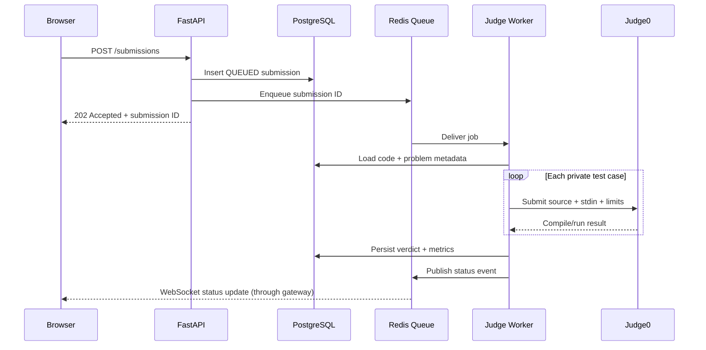

# CodeArena Architecture

## 1. System boundaries

1. **Web client:** renders UI, editor, charts, and realtime updates. It is untrusted.
2. **API:** owns identity, authorization, validation, business rules, and persistence.
3. **Queue:** decouples submission requests from expensive execution.
4. **Judge worker:** claims jobs, calls Judge0, normalizes results, persists verdicts.
5. **Judge0:** isolated execution service; never directly exposed to browser.
6. **AI adapter:** calls selected model provider from backend only.
7. **PostgreSQL:** source of truth.
8. **Redis:** ephemeral cache, rate limits, queue broker, pub/sub.

## 2. Submission sequence



## 3. Backend module boundaries

```text
services/api/app/
├── main.py
├── core/              # config, security, logging, dependencies
├── db/                # session, base, migrations integration
├── models/            # SQLAlchemy models
├── schemas/           # Pydantic request/response schemas
├── api/v1/            # routers
├── services/          # problem, contest, submission, rating, AI
├── repositories/      # database access
├── integrations/
│   ├── judge0.py
│   └── llm/
│       ├── base.py
│       ├── gemini.py
│       ├── groq.py
│       └── openrouter.py
├── workers/           # queue tasks
└── tests/
```

Keep route handlers thin. Business logic belongs in services. External APIs belong behind adapters.

## 4. Frontend module boundaries

```text
apps/web/src/
├── app/               # route segments and layouts
├── components/
│   ├── ui/
│   ├── editor/
│   ├── problems/
│   ├── contests/
│   └── charts/
├── features/
│   ├── auth/
│   ├── submissions/
│   ├── leaderboard/
│   └── ai-assistant/
├── lib/               # API client, auth, utilities
├── hooks/
├── types/
└── styles/
```

Use feature-oriented components and avoid a monolithic page component.

## 5. Data model (high-level)

- `users`: identity, password hash, role, handle, profile visibility.
- `problems`: slug, statement, difficulty, limits, status, author.
- `problem_tags`: many-to-many relation.
- `test_cases`: problem ID, encrypted/private input and expected output, visibility, ordering.
- `contest`: schedule, rules, status, freeze settings.
- `contest_problems`: contest/problem mapping and points.
- `contest_registrations`: user, contest, registration timestamp.
- `submissions`: user, problem, contest nullable, language, source, status, metrics.
- `submission_results`: per-test status and metrics; never expose private input/output.
- `rating_history`: contest, old/new rating, delta, calculation version.
- `notifications`: user, type, payload, read timestamp.
- `audit_logs`: actor, action, resource, timestamp, metadata.

Use UUID primary keys (or bigint IDs consistently), UTC timestamps, foreign keys, uniqueness constraints, and indexes. Store source code in DB initially; consider object storage only if scale requires it.

## 6. API outline

| Method | Endpoint | Purpose |
|---|---|---|
| POST | `/api/v1/auth/register` | Register |
| POST | `/api/v1/auth/login` | Login |
| GET | `/api/v1/problems` | Search/filter problems |
| GET | `/api/v1/problems/{slug}` | Problem detail |
| POST | `/api/v1/submissions/run` | Run custom/sample input |
| POST | `/api/v1/submissions` | Queue judged submission |
| GET | `/api/v1/submissions/{id}` | Submission status/result |
| GET | `/api/v1/users/{handle}/stats` | Profile statistics |
| GET | `/api/v1/contests` | Contest catalogue |
| POST | `/api/v1/contests/{id}/register` | Register |
| GET | `/api/v1/contests/{id}/leaderboard` | Standings |
| WS | `/api/v1/ws/submissions/{id}` | Submission status |
| WS | `/api/v1/ws/contests/{id}` | Scoreboard events |
| POST | `/api/v1/ai/hint` | AI hint |
| POST | `/api/v1/ai/explain` | Explain user-selected code |

All endpoints require pagination, validation, authorization, and documented error responses where applicable.

## 7. Deployment topology

For local development, Docker Compose runs PostgreSQL, Redis, API, worker, web, and optionally Judge0. In production, use separate networks and secrets; expose only the reverse proxy/web/API. Judge0 and worker must not be reachable from the public internet. Scale API and workers independently.
