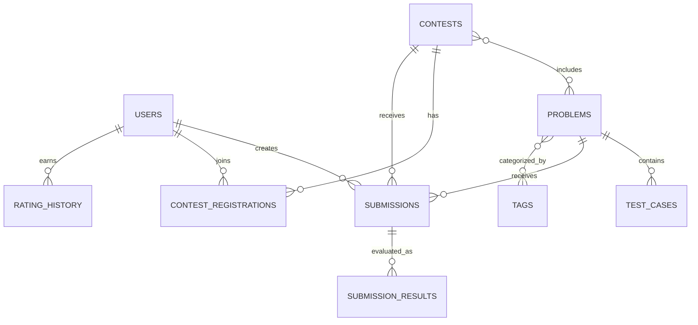

# Data Model Notes

## Core relationships

## Important constraints

- `users.handle` unique, case-insensitive.
- `users.email` unique, normalized.
- `problems.slug` unique.
- `contest_registrations` unique on `(contest_id, user_id)`.
- `submission_results` unique on `(submission_id, test_case_id)`.
- A submission's `contest_id`, if present, must refer to a contest containing that problem.
- Published problem test cases are immutable to ordinary users.
- Store test-case visibility as server-side metadata; never serialize hidden case payloads to public schemas.
- Use database transactions for final verdict persistence and contest-score updates.
